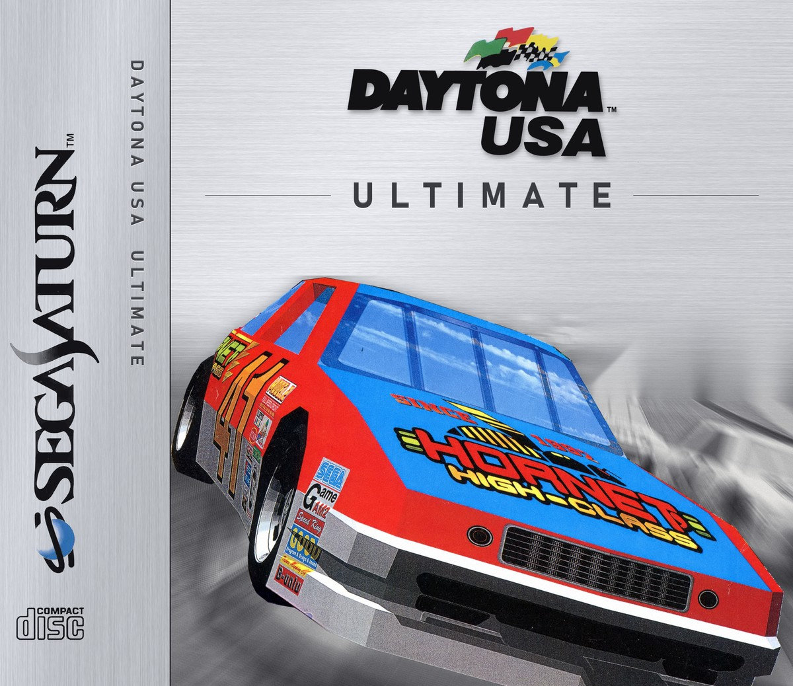
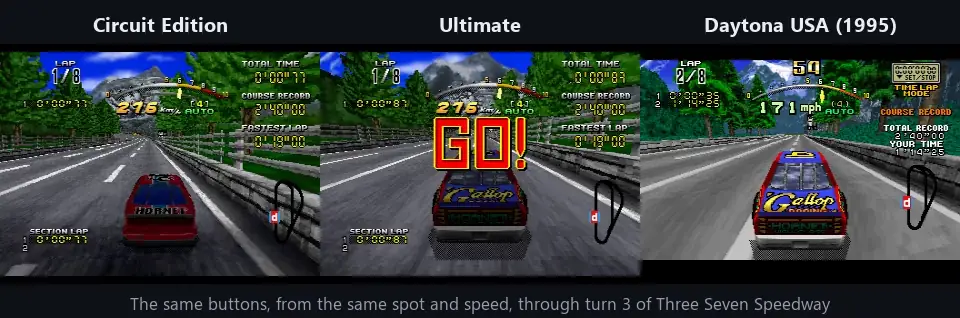
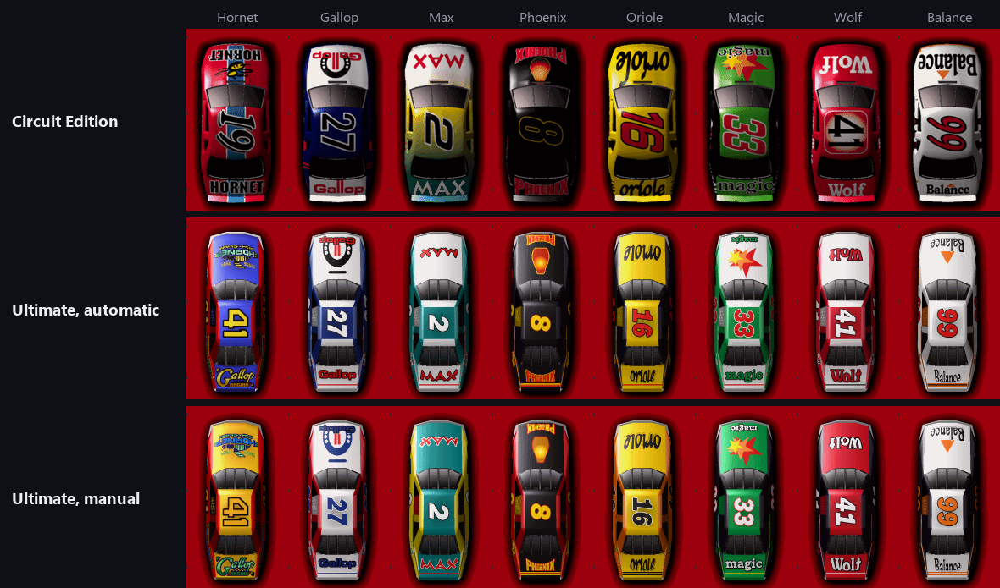
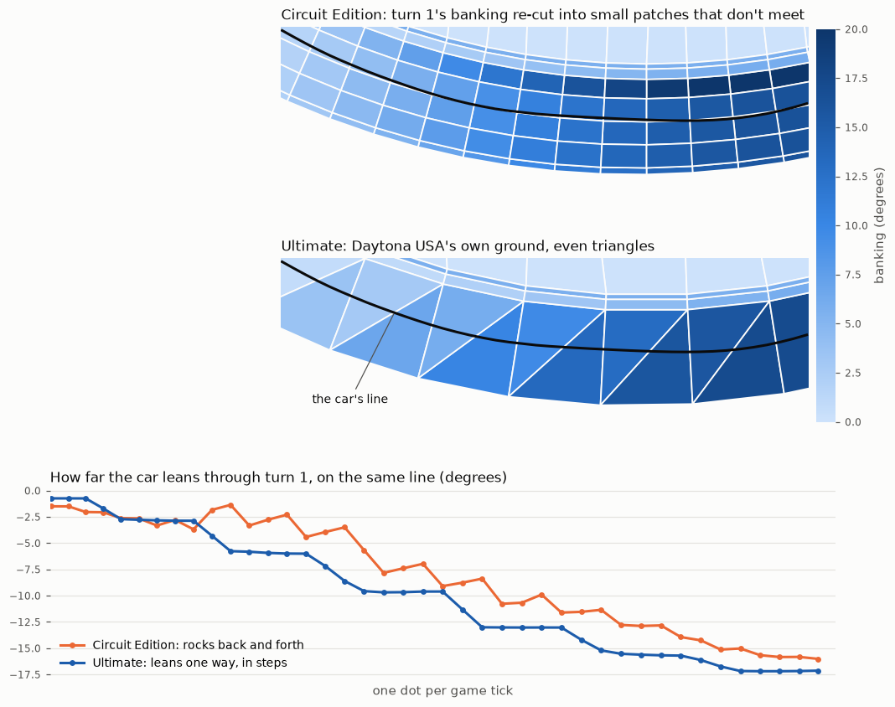
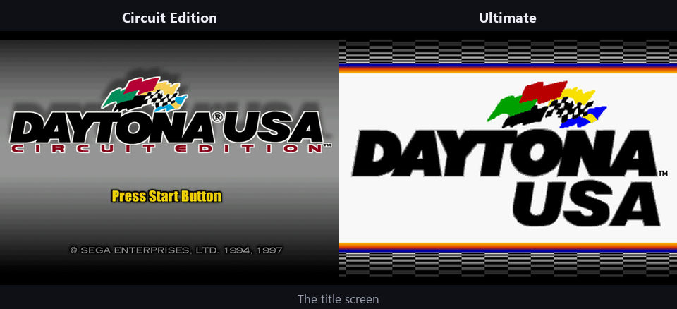
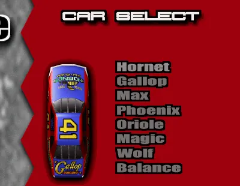

# Daytona USA Ultimate

Daytona USA Circuit Edition for the Sega Saturn, with the handling, cars,
road and sound of the original Saturn Daytona USA.

**Beta.** It's complete and playable, but parts of it have had little
testing (see [Beta notes](#beta-notes)).

No game data is included: you build the disc from your own copies of both
games with the disc builder.

## What's in it

### Daytona USA's handling and camera

The same button presses through turn 3 of Three Seven Speedway in all three
games. Ultimate's car takes the corner on Daytona USA's line; Circuit
Edition's doesn't.

### Daytona USA's car, in seven '95 liveries

Every car is Daytona USA's body. The Hornet keeps Daytona USA's own paint;
the other seven wear '95 liveries drawn for this from Circuit Edition's
cars, a different one for automatic and manual. Car select, the name entry
and the in-car view show them too.

### Daytona USA's road surface on all five courses

What the car drives on, not what you see. Circuit Edition re-cut the banked
turns into small patches that don't meet, and the car rocks across them.
Ultimate drives on Daytona USA's own ground on its three courses, and on
ground made the same way for Circuit Edition's two.

### Daytona USA's engine and tyre sounds

Turn 3 again, with the music, crowd and announcer muted: Circuit Edition,
then Ultimate, then Daytona USA. Turn the sound on.

<!-- VIDEO: sound.mp4 goes here (drag it into GitHub's editor) -->

### Daytona USA's attract mode and title screen

Leave it at the title and it plays Daytona USA's demo, with its song and
camera work, on all three of Daytona USA's courses. Circuit Edition's own
attract is a choice in Options > Sound.

<!-- VIDEO: attract.mp4 goes here (drag it into GitHub's editor) -->

### Ultimate's cars or Circuit Edition's

In car select, left and right switch a car between Ultimate's and Circuit
Edition's original, model and paint. Nothing on screen says so.

### And

- In-car view: the hood of the car you drive, in its livery.
- Two players: both cars on Daytona USA's body, each with Daytona USA's
  engine and tyre sounds.
- Options: HANDLING (NORMAL is Daytona USA's steering), and ATTRACT
  (Daytona USA's or Circuit Edition's).
- The save-memory messages at start-up are in English.
- The disc boots on a Saturn from any region.

## Getting it

1. Download the disc builder from [Releases](https://github.com/AJBats/daytona-cce95/releases)
   (Windows).
2. Have your two discs as Redump-style rips (a .cue with its .bin tracks,
   or a .zip of them):
   - **Daytona USA - Circuit Edition (Japan)**, GS-9100. It's the only
     Circuit Edition this works with: it's the one with the time-of-day
     choice.
   - **Daytona USA**, any of the five Redump dumps: USA, Europe (all three)
     or Japan.
3. Run it, click each cover to choose that disc (or drop the files on the
   window), then press COMBINE. Every track is checked before anything is
   written.
4. The disc comes out in a `Daytona USA Ultimate` folder beside the
   builder, as a .cue and its tracks. Play it in an emulator, or on a
   Saturn from an ODE such as the Satiator.

## Beta notes

- Tested in Mednafen, and earlier builds on a real Saturn with a Satiator.
  Other emulators should work but haven't been tried.
- Races at dusk or at night (Circuit Edition's time-of-day choice) haven't
  been played yet.
- Circuit Edition's XBAND online mode is untouched and untested; its
  servers are long gone.
- A European or other PAL Saturn will boot it, but it's a 60 Hz game: at
  50 Hz it will likely run slower. Untested.

## Building from source

Requires Python 3 and `make`.

1. Put the Redump dumps in `external_resources/`, each with its .cue and
   all its tracks:
   - `Daytona USA (USA)/Daytona USA (USA).cue`
   - `Daytona USA - Circuit Edition (Japan)/Daytona USA - Circuit Edition (Japan).cue`
2. `python3 -m venv .venv`, then
   `.venv/bin/pip install numpy pillow opencv-python-headless`
   (`.venv\Scripts\pip` on Windows)
3. `make disc`

The cars' '95 liveries use Windows fonts (Impact, Arial Black, Franklin
Gothic Heavy Italic, Segoe UI), so the disc is built on Windows.

Output: `build/disc/cce.cue`.

`make release` builds the disc builder (`patcher/`, Tauri; needs Rust) with
the patch from the built disc inside. To take the other Daytona USA dumps
too, put their Redump zips in `external_resources/dusa_dumps/`, with
underscores in place of spaces in the file names.

## Contents

- `patches/`: one byte patch per change, each with a header explaining it
- `tools/`: patching, disc building and analysis tools
- `docs/`: how both games' driving code works, and how each patch was tested
- `patcher/`: the disc builder
